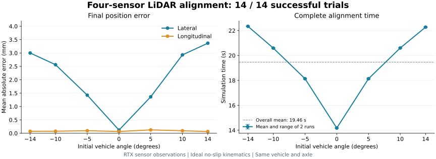
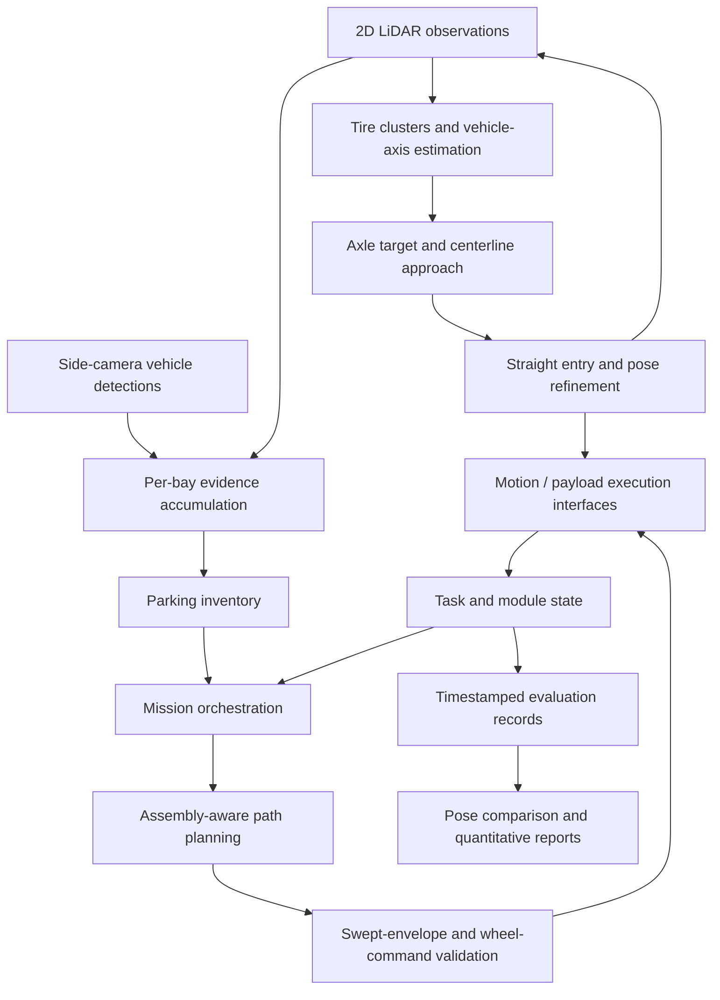

# parking_robot

### 차량 운반형 이중 모듈 주차로봇

**2D LiDAR 기반 휠 정렬 · 다중 센서 주차 인식 · 결합체 경로 검증 · 실물–모의 상태 비교**

NVIDIA Isaac Sim에서 차량 운반형 주차로봇의 인지, 정렬, 경로 계획 및 상태 평가 기능을 구현한 로보틱스 엔지니어링 프로젝트입니다. 차량 하부 진입에 필요한 **차량 방향 추정과 차축 위치 정렬**을 폐루프 제어로 연결하고, 차량과 앞·뒤 모듈을 하나의 운반체로 모델링해 이동 경로의 기하학적 유효성과 구동 제약을 검사합니다.

Python · ROS 2 · NVIDIA Isaac Sim · RTX LiDAR · PhysX · YOLO · AprilTag

[핵심 성과](#engineering-highlights) · [시스템 구조](#architecture) · [정량 결과](#selected-results) · [기술 상세](docs/ENGINEERING.md) · [평가 조건](docs/VALIDATION.md)

## Engineering highlights

| 구현 영역 | 엔지니어링 결과 |
|---|---|
| **LiDAR-only wheel alignment** | 4개 2D LiDAR 관측으로 타이어 위치와 차량 방향을 추정하고, 중심선 접근·직선 진입·재측정 보정을 연결 |
| **Closed-loop pose refinement** | 분위수 기반 대표점과 동일 제어 조건을 사용한 7개 초기 각도, 14회 정렬 시험에서 성공 기준 충족 |
| **Evidence-based parking perception** | 측면 카메라의 차량 검출과 LiDAR 공간 관측을 주차칸별로 누적해 점유 상태와 판정 근거 관리 |
| **Assembly-aware path validation** | 차량·두 모듈의 결합 외곽을 고려한 충돌 검사와 조향각·조향 속도·바퀴 속도·가속도 검사 구성 |
| **ROS 2 mission orchestration** | 주차·회수 임무, 적재 상태, 통로 예약 및 작업 ID를 연계하는 모듈형 제어 구조 구성 |
| **Telemetry comparison** | 좌표계·지도 버전·시계·기준점을 검사하고, 시간 보간 후 위치·방향 차이를 계산하는 평가 모듈 구현 |

## Selected results

### 1. 4개 2D LiDAR를 이용한 차축 정렬

**Isaac Sim의 RTX 센서 관측과 이상적인 비미끄럼 운동학을 결합한 시험**입니다. 동일 차량 모델에서 로봇 한 모듈을 동일 차축에 정렬했습니다. 초기 각도는 `−14°, −10°, −5°, 0°, +5°, +10°, +14°`이며 각 조건을 2회 반복했습니다.

| 측정 지표 | 결과 |
|---|---:|
| 성공 기준을 충족한 정렬 | **14 / 14회** |
| 최종 종방향 평균 절대오차 | **0.085 mm** |
| 최종 횡방향 평균 절대오차 | **2.109 mm** |
| 최종 방향 평균 절대오차 | **0.0023°** |
| 평균 전체 정렬 시간 | **19.46 s** |

성공 조건은 종·횡방향 오차 각각 20 mm 이내, 방향 오차 0.75° 이내, 센서 확인 및 타이어 외곽 이동 검사 통과입니다. 시간은 이동·조향·센서 관측을 포함한 **시뮬레이션 시간**이며, 오차는 시뮬레이터 기준 자세에 대한 평가값입니다. 실물 적용 정밀도와 구분하여 해석합니다.



[14회 시험 데이터](data/alignment_trials.csv) · [집계 JSON](data/alignment_summary.json) · [평가 정의](docs/VALIDATION.md#alignment)

### 2. 이동 관측 기반 주차칸 상태 판정

정적 주차 장면의 **4개 칸**을 대상으로 측면 카메라와 LiDAR 관측을 누적했습니다. 68초의 모의 순찰에서 카메라 추론 136회를 수행하고, 최종적으로 점유 2칸과 빈칸 2칸을 판정했습니다. 관측 시각, 로봇 자세, 센서 근거와 최종 판정을 연결하는 기록 구조를 구성했습니다.

- 좌·우 카메라를 동시에 활성화해 통로 양측을 관측합니다.
- 차량 검출과 LiDAR 점유 근거를 칸별로 누적합니다.
- 빈칸 판정에는 관측 범위 충족 여부를 함께 사용합니다.
- 상태와 함께 판정 근거를 보존해 관측 시점까지 추적할 수 있습니다.

[주차 인식 집계](data/perception_summary.json)

### 3. 결합 운반체의 대표 출차 경로 검증

C-AWS의 탐색 코어를 결합 운반체 모델에 적용하고, 생성된 경로를 공통 충돌·구동 제약 검사기로 평가했습니다.

| 대표 시나리오 | 경로 길이 | 60 Hz 명령 평가 샘플 | 충돌 샘플 | 조향각·바퀴 속도 위반 |
|---|---:|---:|---:|---:|
| RETRIEVAL-01 | 41.86 m | 13,840 | **0** | **0** |
| RETRIEVAL-02 | 63.47 m | 20,923 | **0** | **0** |

두 사례 모두 목표 위치·방향 조건과 연속 구간 분리거리 하한 검사를 충족했습니다. 위 결과는 **오프라인 기하 검사와 이상적인 비미끄럼 바퀴 명령 적분**에 대한 대표 사례입니다. 기존 경로 계획 코어, 결합 외곽 평가, 명령 생성·검증의 책임을 분리해 결과를 해석합니다.

[경로 검증 데이터](data/selected_route_results.json) · [기술적 구성](docs/ENGINEERING.md#planning)

## Architecture



각 기능의 소프트웨어 책임을 나타낸 구성도입니다. 정량 결과는 위에 명시한 시험 단위별로 평가했습니다. 센서 관측, 임무 상태, 기하 검증 및 사후 평가를 분리하여 제어 판단과 평가 기준이 혼합되지 않도록 구성했습니다.

## Technical contributions

### LiDAR-only alignment

타이어 관측점을 차량 길이 방향으로 투영한 뒤, 5백분위수와 95백분위수의 중점으로 종방향 중심을 계산합니다. 좌우 타이어의 기하 관계로 차축 중심과 차량 방향을 추정하고, 중심선 정렬 후 진입 및 재측정 보정을 수행합니다. **강건 통계량을 센서 기하와 피드백 제어에 결합한 구현**에 초점을 두었습니다.

### Perception with traceable evidence

카메라 촬영 시각의 자세와 센서 관측을 대응시키고, 단일 프레임의 검출 결과를 주차칸별 누적 상태로 변환합니다. 점유·빈칸·추가 관측 상태를 구분하며, 각 판정에 사용한 근거를 기록합니다.

### Geometry and actuation constraints

차량 길이·폭, 앞뒤 모듈 간격과 장애물 배치를 경로 평가 변수로 다룹니다. 경로 중심선 외에 전체 운반체의 외곽을 검사하고, 경로 실현에 필요한 바퀴 명령의 제한을 별도로 평가합니다.

### Physics instrumentation and state comparison

PhysX 접촉 시험에서 재질 마찰, 하중·관성, 접촉력과 바퀴·조향 상태를 구분해 수집하는 진단 환경을 구성했습니다. 상태 비교 모듈은 동일 좌표·시계·시행·기준점의 입력을 정합하고, 위치·방향 차이와 비교 유효 여부를 계산합니다.

## Public evaluation tools

저장소는 **기술 포트폴리오, 익명화한 결과 데이터, 독립 실행 가능한 평가 도구**로 구성했습니다. Python 3 표준 라이브러리만으로 공개 지표를 재계산하고 상태 비교 예제를 실행할 수 있습니다.

```bash
python3 tools/summarize_results.py
python3 tools/compare_states.py data/telemetry_fixture.json --max-gap-s 0.2
python3 -m unittest discover -s tests -v
```

상태 비교 예제는 합성 입력이며, 좌표·시계 불일치, 관측 공백, 각도 경계 및 시간 보간을 포함한 **10개 자동 검사**를 제공합니다.

## Repository

```text
README.md                         프로젝트 성과와 시스템 개요
docs/ENGINEERING.md                인지·정렬·경로·관제의 구현 원리
docs/VALIDATION.md                 평가 조건과 지표 정의
docs/assets/alignment-results.svg  각도별 정렬 결과
data/                             공개용 결과 데이터와 합성 상태 예제
tools/                            지표 재계산·상태 비교 코드
tests/                            상태 비교 자동 검사
REFERENCES.md                     활용 기술과 경로 계획 기준 문헌
```

## Technical foundation

RTX 센서와 물리 환경은 NVIDIA Isaac Sim 및 PhysX를 활용하고, 임무 제어 인터페이스는 ROS 2 메시지와 상태 관리 구조로 구성했습니다. C-AWS는 경로 탐색의 기준 구현으로 활용했습니다. 기술별 역할과 원문 링크는 [References](REFERENCES.md)에 정리했습니다.
