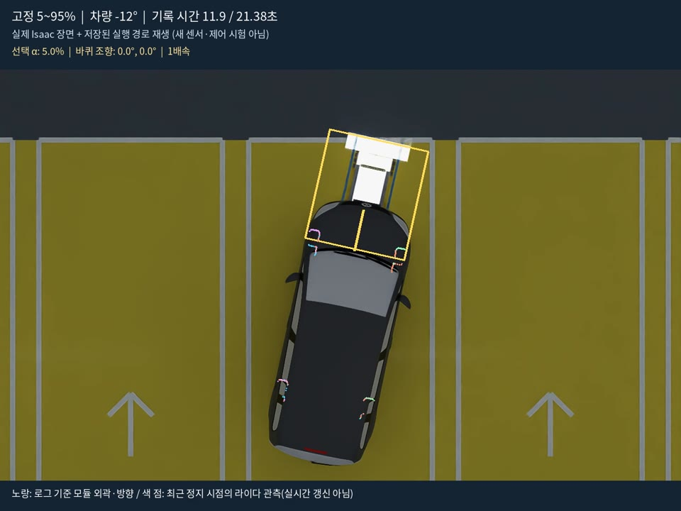
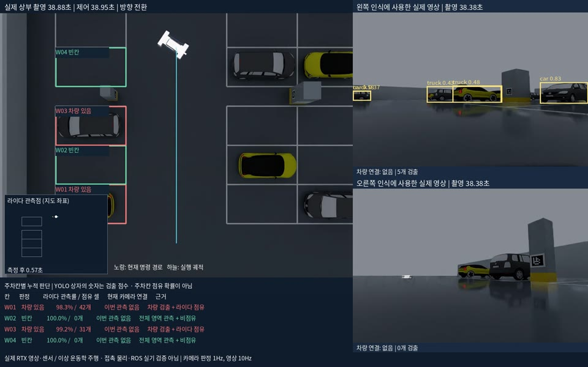
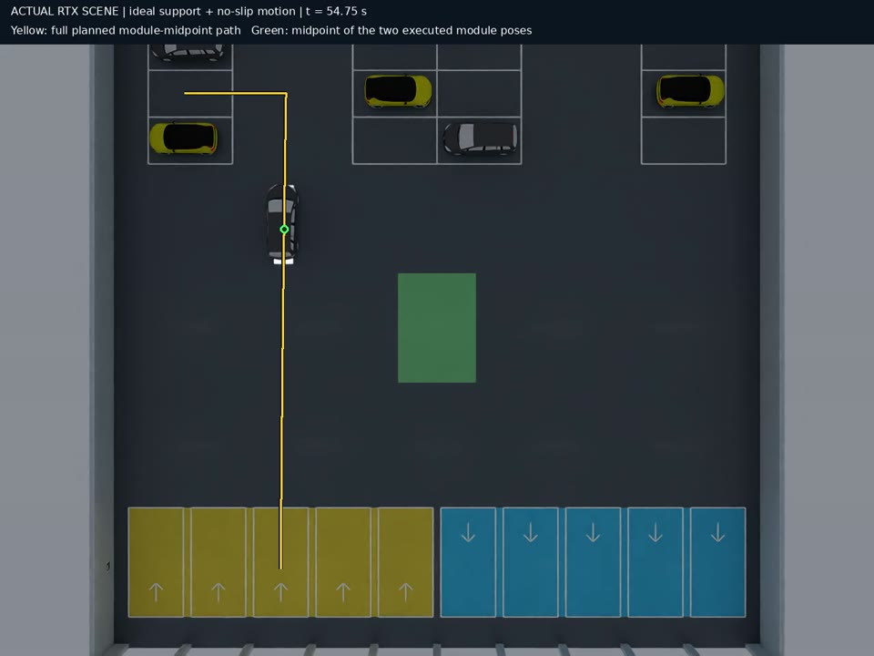
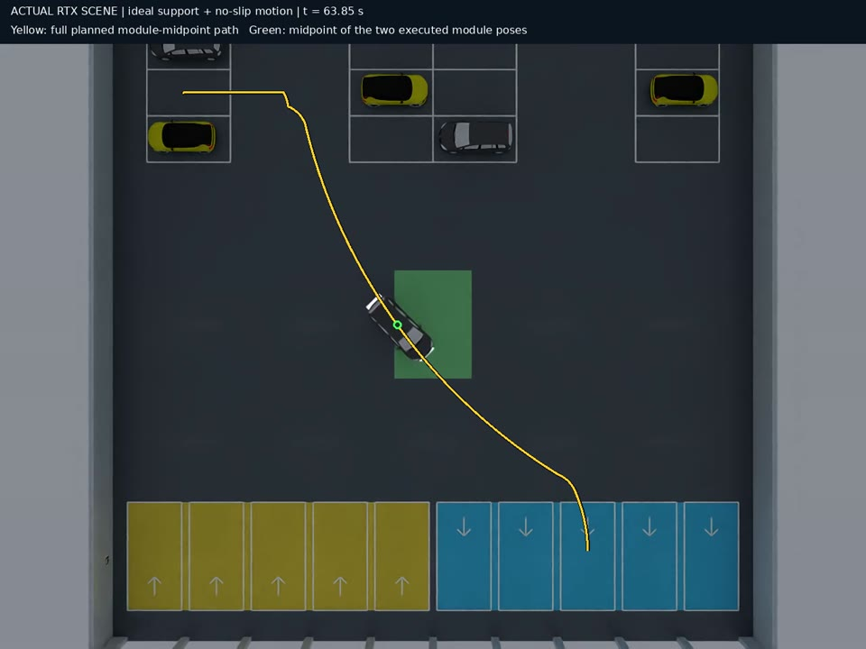
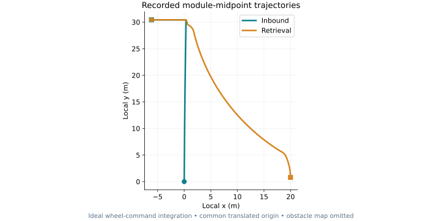

# Demonstration gallery

[프로젝트 개요로 돌아가기](../README.md)

모든 영상은 프로젝트의 Isaac Sim 장면을 사용합니다. 미리보기는 파일 크기와 페이지 반응성을 고려해 해상도와 프레임 수를 줄였으며, 전체 구간을 일정 배속으로 재생합니다. MP4는 원본 녹화의 시간축을 유지했습니다. 영상의 장면 순서나 이동 경로는 변경하지 않았습니다.

| 영상 | 원본 녹화 길이 | GIF 미리보기 | 자료 성격 |
|---|---:|---:|---|
| 차축 정렬 | 21.50 s | 2× | 저장된 바퀴 명령·자세의 Isaac 재생 |
| 주차칸 인식 | 68.00 s | 4× | 실제 RTX 센서 관측과 판정 근거 |
| 입차 이동 | 99.47 s | 6× | 이상 운동학·이상 지지 이동 |
| 출차 이동 | 116.03 s | 6× | 이상 운동학·이상 지지 이동 |

## 01 · Axle alignment

**확인할 내용:** 기울어진 차량의 중심선에 위치와 방향을 맞춘 뒤 직선으로 진입하고, 차축 부근에서 다시 측정해 잔여 오차를 보정합니다.

- 네 모서리 2D LiDAR, 초기 차량 방향 −12°, 고정 5–95% 종방향 중점 설정입니다.
- 기록된 시험의 전체 모의 시간은 21.383초이며, 영상은 10 fps 원본 재생의 끝 프레임을 포함해 21.50초입니다.
- 노란 외곽·방향 표시는 로봇 기준 형상을 보여줍니다. 점 표시는 최근 정지 측정의 저장된 LiDAR 관측이며, 영상 재생 중 새 센서 추론을 수행한 것은 아닙니다.
- 14회 정렬 표와 별도의 시연입니다. 보정 전후 값은 [시연 데이터](../data/alignment_demo.json)에서 확인할 수 있습니다.

[MP4 보기](../media/alignment.mp4) · [움직이는 미리보기](assets/alignment.gif)

## 02 · Parking perception

**확인할 내용:** 상부 시점의 순찰 위치, 좌우 카메라의 검출 상자, 주차칸 상태와 판단 근거가 같은 화면에 연결됩니다.

- 실제 RTX 관측을 사용하며 로봇 이동은 이상 운동학입니다.
- 네 칸에서 최종 점유 2칸·빈칸 2칸을 판정한 68초 기록입니다.
- 검출 상자의 점수는 차량 검출기 출력이며, 최종 주차칸 판정의 정답률을 뜻하지 않습니다.
- 카메라 타일은 최신 사용 프레임을 유지할 수 있으므로, 표시된 촬영 시각과 현재 실행 시각을 함께 읽습니다.

[MP4 보기](../media/perception.mp4) · [판정 집계](../data/perception_summary.json)

## 03–04 · Inbound and retrieval transport

| 입차 구역 → 저장 칸 | 저장 칸 → 출차 구역 |
|---|---|
|  |  |

**확인할 내용:** 노란 선은 전체 계획 경로이고, 초록 표시는 실행된 두 모듈 중점입니다. 차량과 두 모듈이 함께 이동하며 주차장 안에서 방향을 바꾸고 목표 구역에 접근합니다.

이상적인 바퀴 명령 적분과 강체 지지로 구현한 이동 시연입니다. 실제 접촉력을 이용한 차량 적재·하역 성능의 계측 영상과 구분합니다. 이 두 영상은 C-AWS 대표 출차 평가표와 별도 시연입니다.

궤적은 두 시연의 실행 기록을 같은 원점으로 평행 이동한 것입니다. 공개 CSV에는 60 Hz 기록을 약 1초 간격으로 추출하고 마지막 샘플을 포함했습니다. 장애물 지도는 이 도표에 포함하지 않았으며, 실제 장면 배치는 영상을 참고할 수 있습니다.

[입차 MP4](../media/inbound.mp4) · [출차 MP4](../media/retrieval.mp4) · [기록 궤적](../data/transport_demo_traces.csv)

## Visual reading guide

| 자료 | 읽는 방법 |
|---|---|
| [시스템 구조](assets/architecture.svg) | 센서·추정·행동·평가의 역할과 재측정 피드백 |
| [차축 정렬](assets/alignment-pipeline.svg) | 관측 → 목표 추정 → 중심선 접근 → 보정 |
| [결합체 형상](assets/coupled-geometry.svg) | 차량 길이·폭과 모듈 간격을 고려한 외곽 검사 |
| [각도별 성능](assets/alignment-results.svg) | 14회 시험의 각도별 오차와 전체 모의 시간 |
| [보정 전후](assets/refinement-results.svg) | 별도 −12° 시연에서 기록한 최종 오차 변화 |
| [상태 비교](assets/telemetry.svg) | 시각·좌표·기준점을 정합한 뒤 상태 차이 계산 |

구조·형상 그림은 설명용 도해이며 제조사 도면이 아닙니다. 성능 그래프는 공개 결과 데이터로부터 작성했습니다. 영상별 범위·길이·파일 해시는 [미디어 명세](../data/media_manifest.json)에 수록했습니다.
